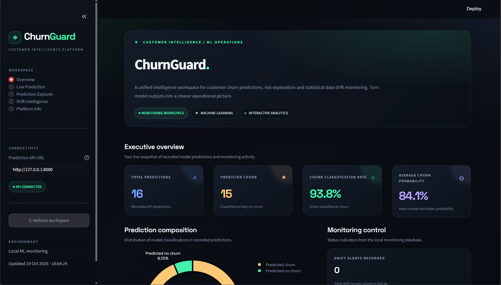
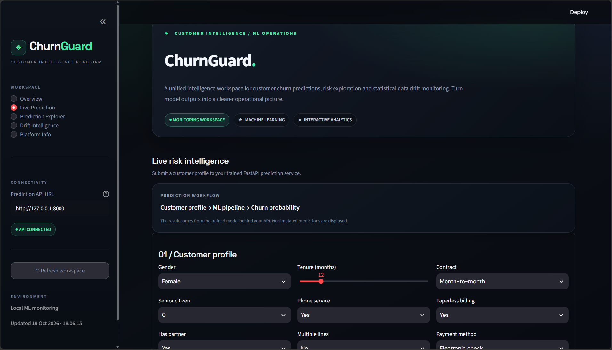
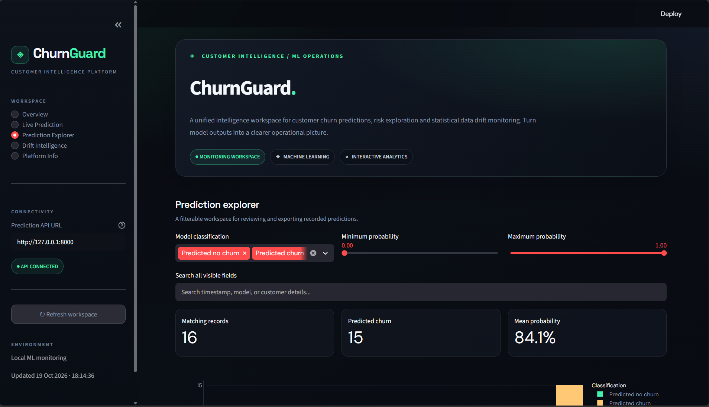
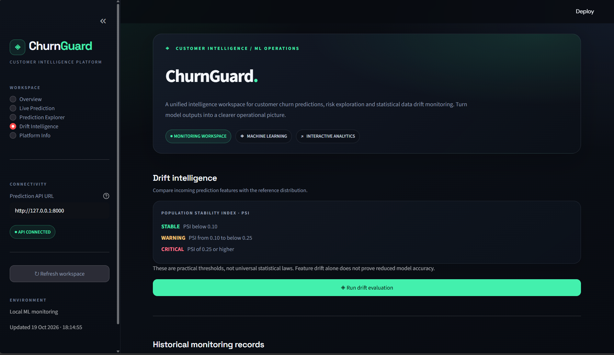

# 🛡️ ChurnGuard
### Customer Churn Prediction & ML Model Monitoring Platform

ChurnGuard is an end-to-end machine learning application that predicts customer churn and provides an interactive monitoring interface for prediction history, model outputs, and statistical data drift.

The platform combines a machine learning pipeline, a FastAPI prediction service, a SQLite monitoring database, and a Streamlit dashboard.

## 📌 Overview

Customer churn is an important business problem for subscription-based services. Identifying customers who may leave can help businesses investigate potential retention opportunities.

ChurnGuard demonstrates how a machine learning model can be integrated into an application with prediction logging and monitoring capabilities.

## ✨ Key Features

- **Customer Churn Prediction:** Estimates the likelihood that a customer will leave a service.
- **Machine Learning Pipeline:** Trains and evaluates Logistic Regression and Random Forest models.
- **REST API:** Serves predictions through FastAPI.
- **Batch Prediction:** Supports predictions for multiple customers.
- **Prediction Logging:** Stores prediction records in SQLite.
- **Interactive Dashboard:** Presents prediction statistics and monitoring history using Streamlit.
- **Data Drift Monitoring:** Uses Population Stability Index (PSI) to compare reference and incoming feature distributions.
- **Automated Testing:** Includes tests for API endpoints, PSI calculations, and database monitoring.

## 🧰 Technology Stack

| Category | Technologies |
|---|---|
| Language | Python |
| Data Processing | pandas, NumPy |
| Machine Learning | scikit-learn |
| API | FastAPI, Uvicorn |
| Dashboard | Streamlit |
| Database | SQLite |
| Visualization | Matplotlib, Seaborn |
| Model Persistence | joblib |
| Testing | pytest |

## 🏗️ Project Architecture

```text
Customer Dataset
       |
       v
Exploratory Data Analysis
       |
       v
Data Preprocessing and Model Training
       |
       v
Saved ML Pipeline
       |
       v
FastAPI Prediction Service
       |
       +-----------------------+
       |                       |
       v                       v
Prediction Logging      Prediction Response
       |
       v
SQLite Monitoring Database
       |
       +-----------------------+
       |                       |
       v                       v
Streamlit Dashboard      PSI Data Drift Checks
```

## 📊 Model Evaluation

The following results were obtained during the project's earlier model evaluation.

| Metric | Logistic Regression | Random Forest |
|---|---:|---:|
| Accuracy | 73.81% | 76.01% |
| Precision | 50.43% | 53.61% |
| Recall | 78.34% | 71.39% |
| F1-score | 61.36% | 61.24% |
| ROC-AUC | 84.13% | 83.51% |

### Model Selection

Logistic Regression achieved a slightly higher F1-score and recall, while Random Forest achieved higher accuracy and precision.

Logistic Regression was the stronger choice when prioritizing F1-score and recall in these experiments. The final choice should reflect the business cost of missed churners versus unnecessary retention interventions.

*These metrics are from the recorded evaluation results and should be regenerated if the dataset, preprocessing pipeline, or evaluation procedure changes.*

## 🖥️ Dashboard Preview

Add screenshots of your working dashboard here.

Suggested screenshots:

1. Executive Overview
2. Live Prediction
3. Prediction Explorer
4. Drift Intelligence

Example Markdown:

```markdown

```

Place the image at `docs/images/dashboard-overview.png` or change the path to match your actual screenshot location.

## 🚀 Getting Started

### Prerequisites

- Python 3.10 or later, compatible with the project's dependencies
- Git
- pip

### 1. Clone the repository

```bash
git clone https://github.com/sahajnigam27/ChurnGuard.git
cd ChurnGuard
```

### 2. Create a virtual environment

Windows PowerShell:

```powershell
python -m venv .venv
.\.venv\Scripts\Activate.ps1
```

If PowerShell blocks activation, use an appropriate execution policy for your environment or run the virtual environment's Python executable directly.

### 3. Install dependencies

```bash
python -m pip install --upgrade pip
pip install -r requirements.txt
```

### 4. Start the prediction API

Open a terminal in the project root and run:

```bash
python -m uvicorn src.api:app --reload --reload-dir src
```

The API should be available at:

- Health check: http://127.0.0.1:8000/health
- Interactive API documentation: http://127.0.0.1:8000/docs

Keep this terminal running.

### 5. Start the dashboard

Open a second terminal in the project root, activate the same virtual environment, and run:

```bash
streamlit run src/dashboard.py
```

Open the local URL displayed by Streamlit, usually:

http://localhost:8501

The API and dashboard must run simultaneously for live predictions to work.

> Note: The application expects its trained model artifacts and any required reference data to be available in the locations configured by the project. Follow the project's existing training workflow if these artifacts are not present.

## 🔌 API Usage

FastAPI provides interactive documentation at:

http://127.0.0.1:8000/docs

Use the documentation to inspect the available endpoints and request schemas.

A successful health check should return an HTTP success status.

For prediction requests, use the exact field names and allowed values defined by the API schema.

## 🧪 Testing

Run the project's automated tests from the repository root:

```bash
python -m pytest -v
```

The test suite is intended to cover API behavior, drift calculations, and monitoring database functionality.

Confirm that all tests pass in your local environment before treating the project as fully verified.

## 📁 Repository Structure

```text
ChurnGuard/
├── data/
│   └── raw/
├── models/
├── reports/
├── src/
│   ├── api.py
│   ├── dashboard.py
│   ├── drift_detection.py
│   ├── eda.py
│   ├── monitoring.py
│   └── train.py
├── tests/
│   ├── test_api.py
│   ├── test_drift_detection.py
│   └── test_monitoring.py
├── .gitignore
├── README.md
└── requirements.txt
```

## 🔮 Potential Future Improvements

- Automated model retraining when meaningful drift is detected
- More detailed monitoring and model performance reports
- Deployment with a publicly accessible API and dashboard
- Additional monitoring metrics and configurable alert thresholds

These are potential improvements, not claims about currently implemented functionality.

---

## 🖥️ Dashboard Preview

### 1. Executive Overview
View prediction statistics, churn classification metrics, and monitoring activity.


### 2. Live Prediction
Explore the customer prediction interface and its API connectivity.



### 3. Prediction Explorer
Review recorded predictions and explore customer churn classifications.



### 4. Drift Intelligence
Inspect the interface for statistical data drift monitoring.



## 👨‍💻 Author

**Sahaj Nigam**

B.Tech Computer Science Engineering — Artificial Intelligence & Machine Learning

- GitHub: [@sahajnigam27](https://github.com/sahajnigam27)

---

*ChurnGuard is a machine learning portfolio project demonstrating churn prediction, API integration, interactive visualization, and statistical data monitoring.*
